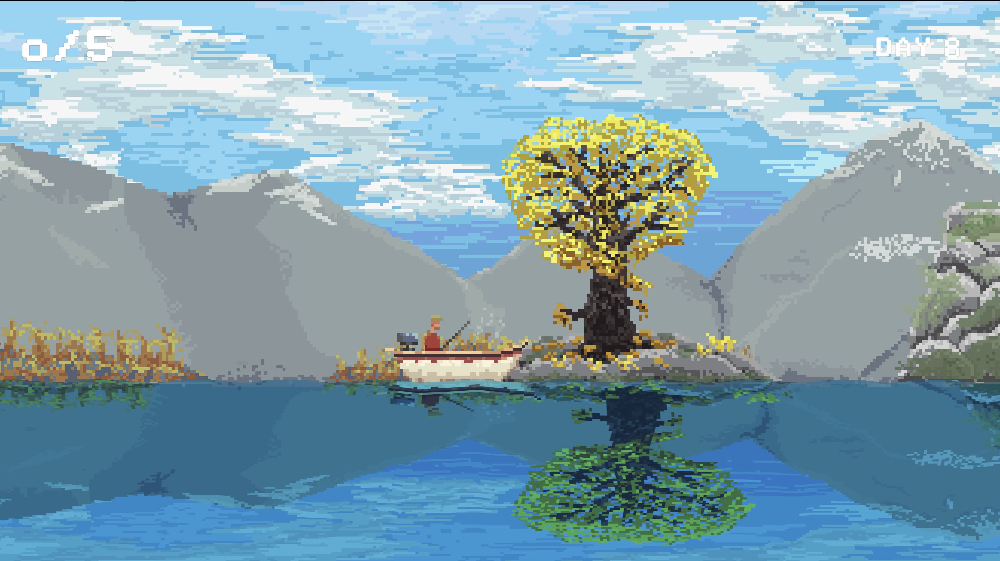
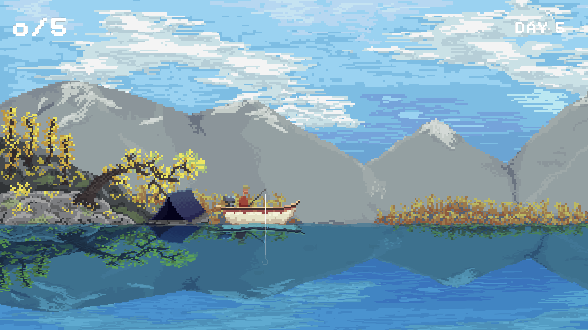
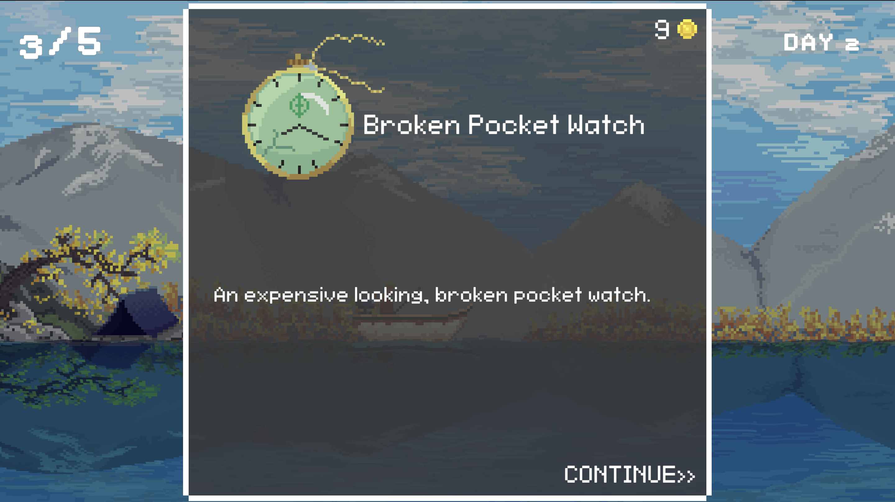

# Still-Waters
A fishing horror game made for The Fishing Horror Jam

Game Link: https://saarishtthaman.itch.io/still-waters

## Remake (this branch)

This branch is a Unity 6 remake of the jam game for Web and Android. It has an expanded story about Wes, his brother Dan, and the hidden lake from their childhood, plus fairer RNG, longer days, saves, touch controls, haptics, a reworked reel minigame, and an optional FM radio. The original jam project is on `main`. See [REMAKE_NOTES.md](REMAKE_NOTES.md) for how it's built, what changed, and how to test it.

Radio music by Kevin MacLeod (incompetech.com), licensed under CC BY 4.0.

